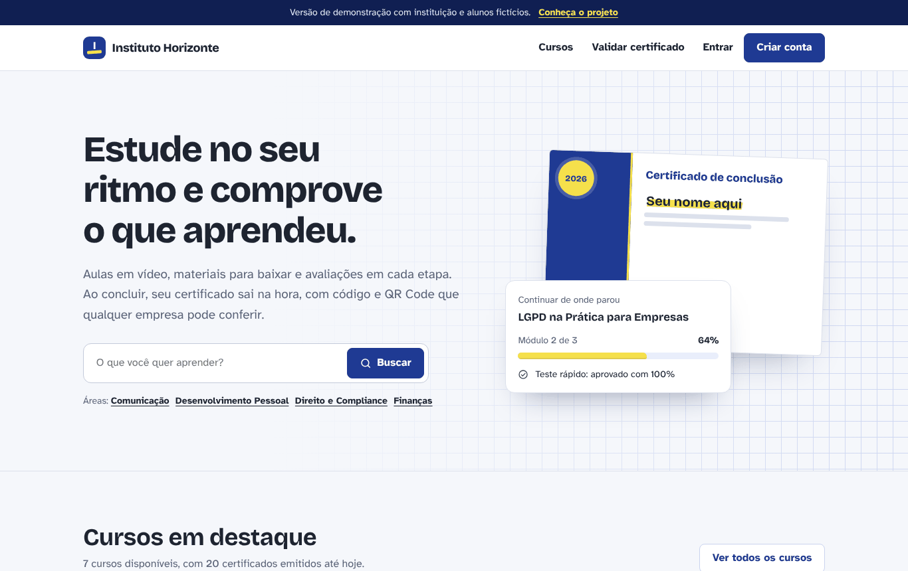
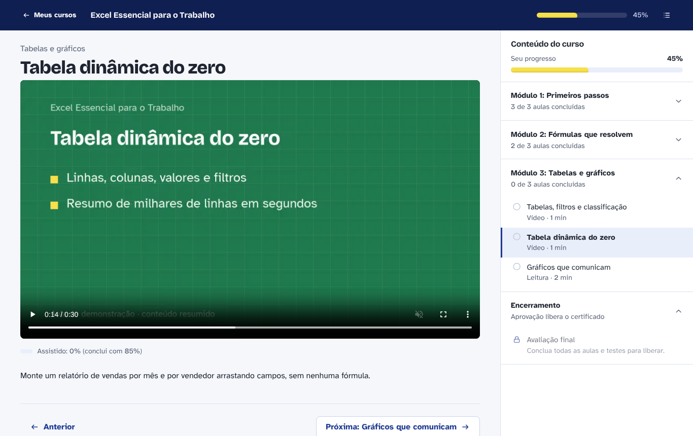
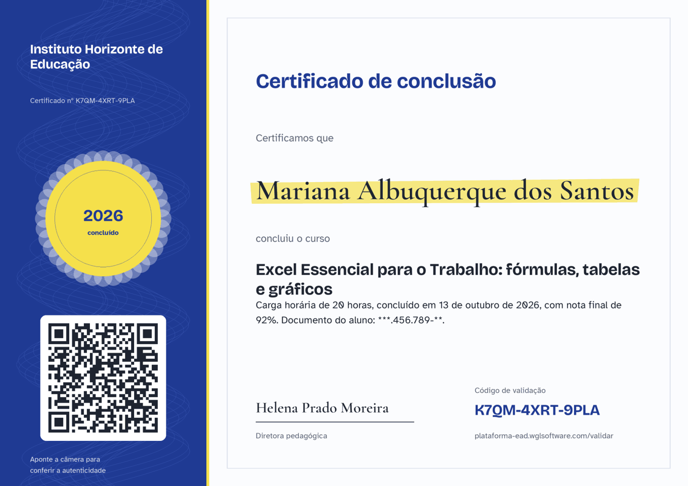
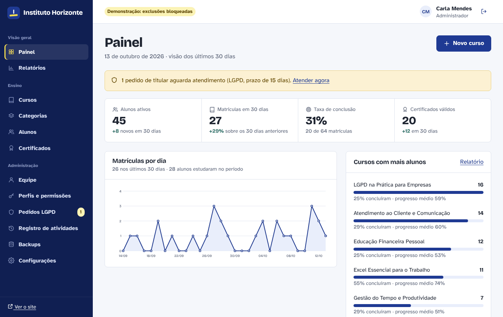
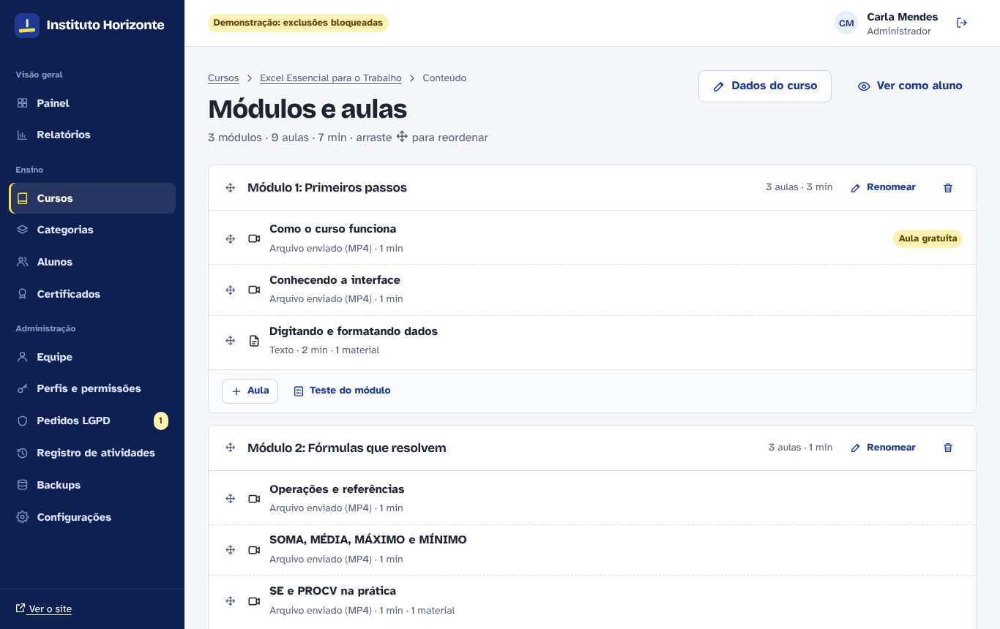
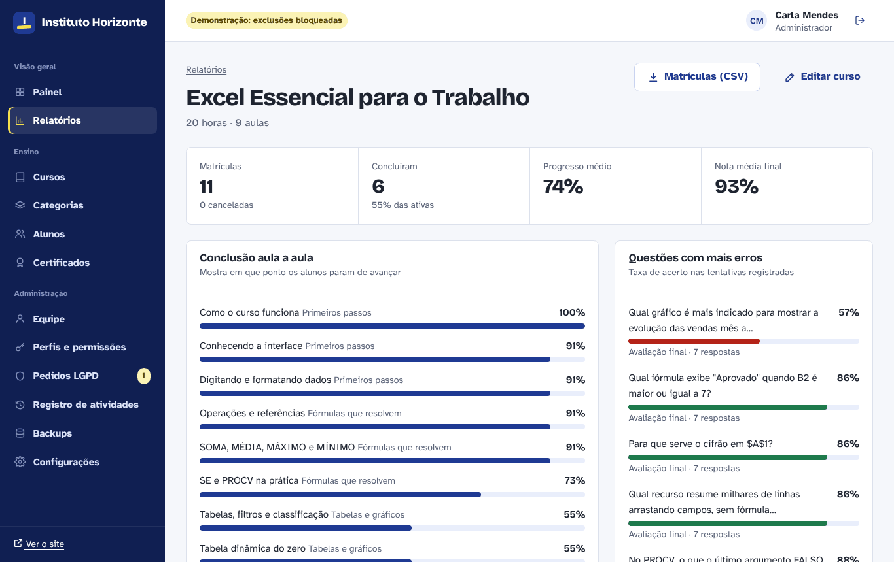
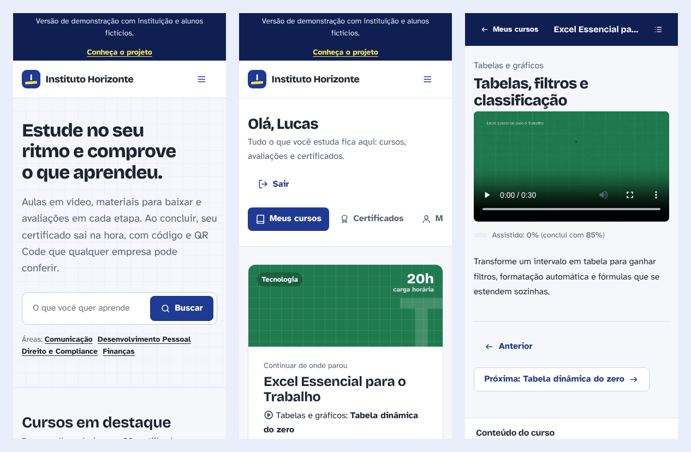

# Plataforma EAD

Plataforma de cursos online completa (LMS) feita **em PHP puro, sem framework e sem nenhuma dependência externa**: catálogo público, área do aluno com player que retoma de onde parou, avaliações, certificados em PDF com QR Code e validação pública, e um painel administrativo com relatórios, permissões, auditoria, backup e ferramentas de LGPD.

**Demonstração:** https://plataforma-ead.wglsoftware.com
Acesso de teste (senha `demo1234`): `aluno@demo.com` · `admin@demo.com` · `coordenacao@demo.com` · `suporte@demo.com`

> A instituição (Instituto Horizonte), as pessoas e os dados da demonstração são fictícios.



## O que a plataforma faz

**Área pública**
- Página inicial, catálogo com busca e filtros (área, nível, carga horária, ordenação)
- Página do curso com carga horária, grade completa, requisitos, instrutor e aula gratuita
- Cadastro, login, recuperação de senha por e-mail
- Validação pública de certificados pelo código ou QR Code

**Área do aluno**
- "Continuar de onde parou": abre a aula e o minuto exatos em que o aluno parou
- Player que mede o tempo **realmente assistido** (pular para o fim não conclui a aula)
- Vídeos próprios (com streaming por Range), YouTube, Vimeo, Panda Video e Bunny Stream
- Materiais complementares protegidos (só baixa quem está matriculado)
- Testes por módulo e avaliação final, com nota mínima, limite de tentativas e correção comentada
- Certificado emitido automaticamente na conclusão, em PDF, com botão para adicionar ao LinkedIn
- Perfil, troca de senha, foto, e uma área de privacidade para exportar os dados e pedir exclusão

**Painel administrativo**
- Indicadores: alunos ativos, matrículas, taxa de conclusão, certificados, gráfico diário
- Cursos, categorias, módulos e aulas com reordenação por arrastar e soltar (e por teclado)
- Upload de vídeos e materiais com validação do tipo real do arquivo
- Editor de avaliações (múltipla escolha, gabarito, explicação por questão)
- Alunos: busca, filtros, matrícula manual, cancelamento, emissão manual de certificado
- Certificados: busca, revogação com motivo, reativação, detecção de adulteração
- Relatórios: funil de engajamento, conclusão aula a aula, questões com mais erros, exportação CSV
- Equipe e perfis com permissões granulares (Administrador, Coordenação, Suporte ou perfis novos)
- Registro de atividades (auditoria), backups do banco, fila de pedidos LGPD
- Configurações: nome, WhatsApp, assinatura do certificado, Google Tag Manager e Analytics

## Telas

| Player do aluno | Certificado gerado pelo sistema |
|---|---|
|  |  |

| Painel administrativo | Montagem do curso |
|---|---|
|  |  |

| Relatório do curso | Celular |
|---|---|
|  |  |

## Tecnologia

| | |
|---|---|
| Back-end | PHP 8.1+ com arquitetura MVC própria: roteador com parâmetros, middlewares, validação declarativa, views com layouts |
| Banco | MySQL 5.7+/8 ou MariaDB 10.4+, 23 tabelas com chaves estrangeiras e índices |
| Front-end | HTML, CSS e JavaScript puros; responsivo; fontes hospedadas no próprio servidor |
| Dependências | **Nenhuma.** PDF, QR Code, cliente SMTP, gráficos SVG e backup foram escritos do zero |
| Hospedagem | Qualquer hospedagem compartilhada com PHP e MySQL (Apache ou LiteSpeed) |

Componentes próprios que normalmente viriam de bibliotecas:

- [`app/Lib/QrCode.php`](app/Lib/QrCode.php): codificador QR (ISO/IEC 18004), Reed-Solomon em GF(256), escolha de máscara por penalidade. Testado com leitor real nas versões 1 a 10.
- [`app/Lib/PdfDocument.php`](app/Lib/PdfDocument.php): gerador de PDF 1.4 com imagem JPEG e link clicável no QR Code.
- [`app/Lib/CertificateRenderer.php`](app/Lib/CertificateRenderer.php): desenho do certificado em GD com fontes TTF e padrão de segurança.
- [`app/Core/Mailer.php`](app/Core/Mailer.php): cliente SMTP com SSL/STARTTLS.
- [`app/Services/BackupService.php`](app/Services/BackupService.php): dump completo do banco em PHP (sem `mysqldump`).

## Segurança e LGPD

- Senhas com bcrypt, sessão com cookie `HttpOnly`/`SameSite` e expiração por inatividade
- CSRF em todos os formulários e chamadas AJAX; limite de tentativas de login
- Consultas sempre preparadas; toda saída escapada; Content-Security-Policy com nonce
- Vídeos e materiais fora da pasta pública, entregues só a alunos matriculados
- Uploads validados pela extensão **e** pelo tipo real; imagens reprocessadas (remove metadados e cargas escondidas)
- Certificados assinados com HMAC-SHA256: qualquer alteração direta no banco aparece na validação
- Consentimentos guardados com versão, data e IP; GA/GTM só carregam após o aceite (Consent Mode v2)
- Exportação dos dados pelo próprio aluno (JSON) e exclusão por anonimização, preservando estatísticas e certificados

Detalhes em [docs/seguranca-e-lgpd.md](docs/seguranca-e-lgpd.md).

## Rodando localmente

```bash
cp .env.example .env              # ajuste banco e APP_URL
php bin/ead key                   # cole o valor em APP_KEY
php bin/ead demo --force          # cria o banco com os dados de demonstração
php -S 127.0.0.1:8000 -t public public/index.php
```

Abra http://127.0.0.1:8000. Para uma instalação limpa, sem dados de demonstração: `php bin/ead install`.

## Testes

```bash
php tests/smoke.php                       # todas as páginas, com cada perfil e as permissões esperadas
node tests/e2e/fluxo-aluno.js             # cadastro → matrícula → aulas → avaliação → certificado → validação
node tests/e2e/fluxo-admin.js             # curso → módulo → aulas → material → avaliação → certificados → CSV
```

Os testes ponta a ponta usam [Playwright](https://playwright.dev) (`npm i -D playwright`).

## Documentação

- [Arquitetura](docs/arquitetura.md): pastas, fluxo de uma requisição, modelo de dados, regras de progresso
- [Instalação e deploy](docs/instalacao-e-deploy.md): local, Hostinger (com e sem SSH), cron de backup
- [Segurança e LGPD](docs/seguranca-e-lgpd.md)
- [Integrações](docs/integracoes.md): vídeo (YouTube, Vimeo, Panda, Bunny), e-mail SMTP, Google Tag Manager/Analytics, WhatsApp

## Licença

Código publicado como portfólio. Todos os direitos reservados a WGL Software; para uso comercial, entre em contato.

---

Desenvolvido por **Wagner Gonçalves Longo Filho** · [WGL Software](https://wglsoftware.com)
